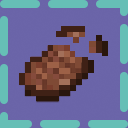
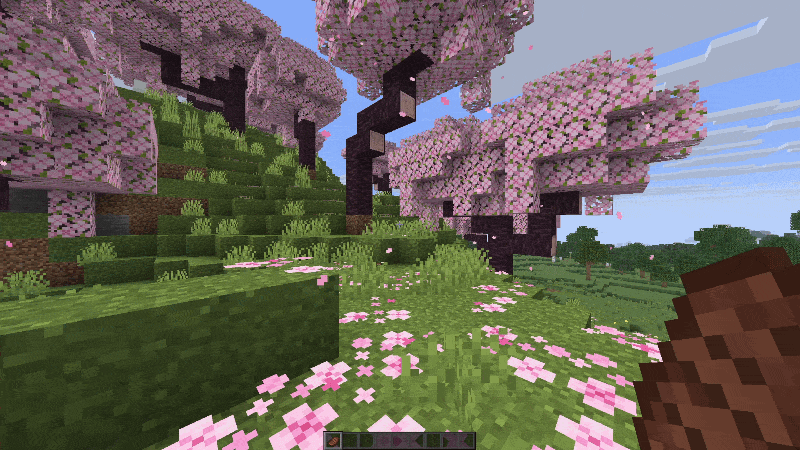

# Eating Animation (Horizon native mod)



It is a port of [Eating Animation](https://github.com/Theoness1/EatingAnimation) for Horizon.

While you eat food, or drink a potion or milk, the item in your hand shows its bitten frames.
The frames come from a resource pack you build from your own copy of the EatingAnimation
download with `tools/make_frame_pack.py`, and drop into Horizon's `resourcepacks/` folder.



## Build

```sh
horizon-launcher native-build . --trust-native-code
```

## License

MIT. See [LICENSE](LICENSE).
