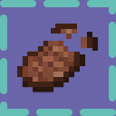
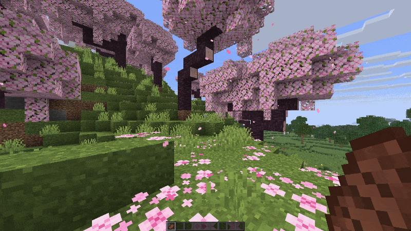

# Eating Animation (Horizon native mod)



**Port of Eating Animation for Horizon.** Based on [Eating Animation](https://github.com/Theoness1/EatingAnimation) by Theoness1.



## What it does

While you eat food, or drink a potion or milk, the item in your hand shows its bitten frames as you go.

The frames are built into the mod. No resource pack is needed: the textures and models are compiled into the native
build as a content mod (`mixins/eatinganimation/data/eatinganimation-content.hmod`), and loaded with the game's resources.

To rebuild that content from a frame pack (for example a new version of the Eating Animation textures):

```sh
python3 tools/pack_to_content.py <frame pack (zip or folder)> mixins/eatinganimation/data/eatinganimation-content.hmod
```

The frame pack can be the one `tools/make_frame_pack.py` makes from the original EatingAnimation download.

## Build

```sh
horizon-launcher native-build . --trust-native-code
```

## Credits

- Eating Animation by [Theoness1](https://github.com/Theoness1/EatingAnimation).

## License

MIT. See [LICENSE](LICENSE).